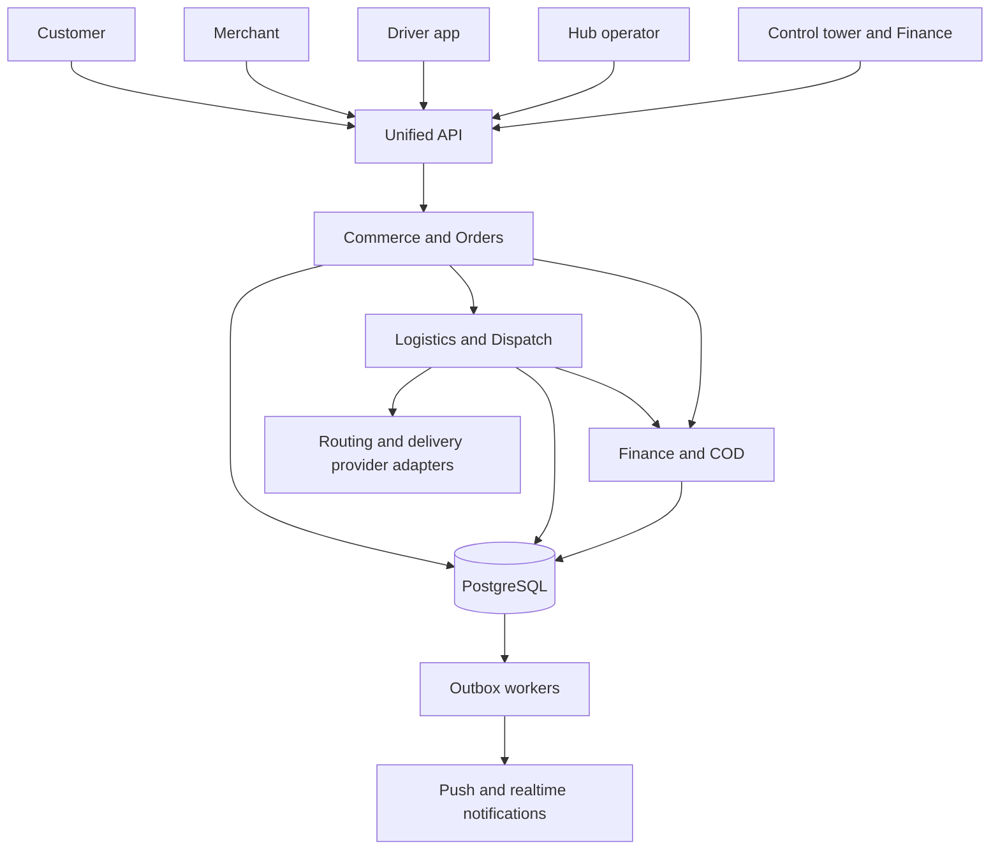

# DilMart 2.0 — Master Product, Architecture & Operations Specification

**Version:** 1.0.0 — pre-audit baseline  
**Date:** 2026-11-25  
**Status:** Product direction agreed; implementation contracts proposed, pending Phase 0 verification and owner sign-off  
**Repository:** dilmart-info/Dilmart  
**Target:** Baghdad, controlled commercial launch within 30 days (target 2026-12-25; not an unconditional release commitment)  
**Audience:** Product owner, operations, engineering, QA, finance and AI coding agents.

> هذه الوثيقة المرجعية الموحدة تصف الرؤية ونطاق العمل وقواعد التشغيل للنسخة الثانية. ليست تقريراً عن إنجاز الكود أو تفويضاً بتعديل الإنتاج. المستودع عام؛ لا تدرج هنا أسماء التجار أو بياناتهم أو عقودهم أو أرقامهم أو أسرار البنية التحتية. تُحفظ التفاصيل التجارية الحساسة خارج المستودع العام.

## 1. Executive summary and decisions

DilMart 2.0 is a unified commerce, logistics and financial infrastructure for Iraq, Arabic/RTL first. A customer purchases from multiple independent merchants in one checkout. Merchant orders are prepared separately. Geographically distributed pickup drivers collect ready parcels in parallel and deliver to a DilMart consolidation hub. The hub verifies, sorts and consolidates the parcels; last-mile drivers deliver the complete order and collect COD. A central financial ledger reconciles cash custody, merchant liabilities, commissions and driver earnings.

Confirmed product direction: marketplace + multi-merchant cart; own first-mile and last-mile operation; central consolidation hub; dynamic dispatch; integrated accounting; phased launch in Baghdad. Merchant recruitment is underway; actual signed and operationally ready merchants must be verified by operations before activation. No demand forecast or fleet capacity is assumed proven.

Proposed engineering decisions: evolve the existing repository rather than rebuild; NestJS modular monolith, PostgreSQL/Supabase, spatial queries using PostGIS, provider-independent routing, transactional outbox and idempotent workers, one driver app with role-based modes, reusable customer/merchant/admin surfaces. Preserve Jenni as an explicitly chosen external option, never as an implicit duplicate dispatch. Single hub for launch; multiple hubs later. Physical cross-docking, not long-term warehousing.

## 2. Product family and scope

| Product | Responsibilities | Launch |
|---|---|---|
| DilMart Marketplace | Discovery, catalog, multi-vendor cart, checkout, order tracking, customer support | P0 |
| DilMart Merchant | Onboarding, pickup locations, catalog, inventory, commercial agreements, order preparation, labels, earnings, returns | P0 |
| DilMart Logistics | Parcels, pickup batches, hub intake, sorting, consolidation, outbound manifests, returns, dispatch and operations control tower | P0 |
| DilMart Driver | Pickup / delivery / hybrid modes, shifts, location, task acceptance, scan, custody, navigation, proof, cash handover | P0 |
| DilMart Finance | Immutable financial snapshots, COD, reconciliation, merchant payable, driver earnings, disputes, payouts | P0 |
| DilMart Intelligence | Rule-based dispatch, ETA, exceptions, alerts, operational metrics | P0 basic; optimization and ML later |
| DilMart Pay | Licensed payment-provider integrations; no unlicensed wallet or stored value | Future, separate compliance gate |

P0 means release-blocking. P1 means enhance after stable release unless required to safely execute P0. P2 means expansion. Do not confuse full end-to-end operational readiness with delivering every aspirational feature. Marketplace includes current B2C functionality; existing B2B/barber/federated flows must not regress. Any general-category expansion requires category and fulfillment eligibility rules.

## 3. Current repository evidence and Phase 0 boundary

Earlier read-only review of main tree 10d11c0d79cf8e3597723fbf296b9cf90bcb2979 found:
- [README](../../README.md) describes multi-vendor marketplace and Jenni COD integration.
- [cart-store.ts](../../src/lib/cart-store.ts) uses activeMerchantId and rejects different merchants.
- [checkout.service.ts](../../backend/src/modules/checkout/checkout.service.ts) rejects carts with more than one merchant and directly resolves Jenni prices.
- [delivery-operations.service.ts](../../backend/src/modules/shipping/delivery-operations.service.ts) models assignment, delivery status transitions, event logging, and agent/company scope at order grain.
- [AgentOrders.tsx](../../src/pages/AgentOrders.tsx), [Agents.tsx](../../src/pages/admin/Agents.tsx), [DeliveryOps.tsx](../../src/pages/admin/DeliveryOps.tsx), [DeliveryIntelligence.tsx](../../src/pages/admin/DeliveryIntelligence.tsx) provide reusable surfaces.
- [order-finance.service.ts](../../backend/src/modules/finance/order-finance.service.ts) and [M11-R closure report](../batch-m11-r-settlement-operations-closure-report.md) provide a starting point for COD, accrual/payable, payouts and idempotency.
- [AGENTS.md](../../AGENTS.md) requires environment verification and states that Store has no separate staging today. The current authoritative environment document must be read before work.

These observations are not a fresh audit, deployment verification, test result or schema inventory. Phase 0 must check current HEAD, routes, actual migrations/RPCs, RLS, stock and coupon authority, payment/settlement invariants, dependencies, provider side effects, and current mobile packaging. Record reuse / adapt / replace decisions with file and line evidence. Reconcile any conflict between this proposed design and verified current implementation with the owner. No blind file moves or global rename.

## 4. Architecture and ownership

One authoritative database and API; logically isolated modules with explicit contracts. UI must not directly change privileged order, custody, cash or ledger state. Use server-side validated commands and transactional SQL where atomic cross-module writes are needed. No microservice split for launch. Keep existing repository structure; a new driver-mobile workspace is a proposal, not a mandatory relocation. Version public contracts; use additive migrations and backward-compatible flags.

Domain authority: Commerce owns stock, cart, pricing and merchant orders. Logistics owns packages, tasks, manifests, routes and custody. Finance owns amounts, allocations, liabilities, cash and settlement. Identity owns actor scope. Intelligence owns recommendations, never authoritative cash/state. Customer-facing order summary is a projection of authoritative child states, not an independent editable truth.

## 5. Actors and permissions

| Actor | Allowed scope |
|---|---|
| Customer | Own cart, address, orders, receipts, support/return requests |
| Merchant owner/manager/staff | Own merchant, authorized locations, products, order preparation, own financial reports per role |
| Pickup driver | Assigned pickup tasks, parcel labels, merchant pickup contacts, hub handoff; no unrelated customer data or payouts |
| Delivery driver | Assigned outbound tasks, necessary customer contact/address, COD, proof, return custody |
| Hub receiver/sorter/packer | Assigned hub intake, inspection, bins, consolidation, packing and manifests; no payout approval |
| Dispatcher | Driver availability, routes, reassignment, exception management |
| Cashier | Cash receipts, custody handover and reconciliation |
| Finance approver | Review discrepancies, approve/settle payouts, authorized adjustments |
| Platform administrator | Configuration and audited exceptional intervention; least privilege |
| System worker | Narrow service permissions for outbox/dispatch/projections |

Driver permissions combine actor ID, assigned task, mode, shift and provider/company scope. Merchant staff cannot see other merchants in a parent order. Cash handover and payouts require maker/checker separation where staffing permits; high-risk adjustments require separate approval. Override commands require reason, before/after state and actor.

## 6. Marketplace, multi-merchant checkout and inventory

Customer can add items across merchants without clearing the cart. Group by merchant/pickup location for display, validation and fulfillment. Show per-group availability, promotions, quantities, estimated readiness, final delivery window and transparent fee. Arabic addresses include district, landmark, phone and map pin; require verified coordinates for automated delivery. Reject unsupported product types/locations before checkout.

Backend is authoritative for pricing, taxes if applicable, stock, product visibility, merchant status, discounts and commercial rules. Never trust client price, merchant ID or delivery fee. Quote includes version, expiry, groups, totals, discount allocation, delivery method and promise. Submit uses idempotency key scoped to actor/session and request hash; same key with changed payload returns conflict. One transaction creates master order, existing merchant-order children (candidate reuse of orders), order items, inventory reservation/decrement according to verified current rules, immutable money snapshots and outbox events. All-or-nothing checkout creation; subsequent merchant rejection is a compensating business event, not rollback of other accepted orders.

Reorder, guest/account linking, cart persistence/migration, coupons (platform and merchant scope), B2B surfaces, concurrent purchases and retry behavior must be audited. Allocate global discounts and fees using deterministic integer-IQD allocation with remainder distribution, sum exactly conserved. Do not duplicate delivery fee across sub-orders. Preserve historical single-merchant order semantics; no forced retroactive migration of settled orders. Merchant sees only own order and pickup window.

Merchant acceptance validates stock/reservation and records estimated ready_at. Separate ACCEPTED from READY_FOR_PICKUP; acceptance can trigger preplanning, but actual dispatch must respect readiness and service window. Rejection releases reservation exactly once and updates financial/customer projections. Timeout creates exception; do not silently cancel/refund without policy and notification. If customer changes address or cancels, revalidate availability, price, route and physical custody.

## 7. Lifecycle and entities

State names below are conceptual, not approved enum migrations. Maintain separate state machines.

| Entity | Typical lifecycle |
|---|---|
| Master order | pending_merchant_confirmation → preparing → collecting → consolidating → ready_for_delivery → out_for_delivery → delivered; partial / cancelled / exception as derived outcomes |
| Merchant order | pending → accepted → ready_for_pickup → picked_up → at_hub → fulfilled; rejected/cancelled/returned as applicable |
| Package | expected → labeled → picked_up → received_at_hub → sorted → packed → outbound → delivered; quarantined/returned/missing branches |
| Pickup task | queued → offered → assigned → en_route → arrived → collected → hub_handover → completed |
| Outbound task | queued → assigned → loaded → en_route → delivered or failed → return_handover if needed → completed |
| Cash custody | expected → collected → held_by_driver → handed_over_pending_count → reconciled / discrepancy |
| Merchant settlement | not_accrued → accrued → payable → batch_pending → approved → settled / disputed / reversed |

State transitions are explicit guarded commands. A package cannot be received before custody transfer unless an authorized exception is recorded. No direct status jump by clients. Duplicate events must be harmless, stale version updates rejected, terminal history preserved. Completion of all required packages is not equivalent to customer delivery or payable settlement. Failed attempt is not necessarily terminal; retry is a new attempt on the task with audit. Customer partial delivery/cancellation policies must be agreed before launch.

## 8. Logistics: intelligent hub-and-spoke

First mile: geographically distributed pickup drivers, dynamic zones and ready-time-aware dispatch. Last mile: hub-origin routes grouped by customer geography, delivery windows, package/cash capacity and SLA. Hub: cross-docking, barcode custody, consolidation, packing and outbound handover. At launch one hub; add hub_id to relevant entities so future expansion is possible without hardcoding one physical location.

Example: customer purchases from a Karada merchant and an Al-Rasheed Street merchant. Once each is ready, dispatch selects appropriate pickup drivers independently. Mohammed collects the first parcel; Abbas collects the second. Both can collect other merchants' parcels in the same tour. At the hub staff scan both into the same consolidation bin; only after all required parcels are verified is the outbound shipment released. Customer receives one delivery and one COD amount if policy allows. If a package is late, customer receives an update and an approved resolution, never an indefinite silent wait.

Batch pickup by merchant location and compatible readiness windows, bounded by SLA and vehicle capacity. Do not generate one physical stop per order when multiple packages can be collected together. Driver route contains stop and package manifest; one driver may serve many orders. A master order can have multiple shipments if explicitly authorized. One shipment can contain packages from multiple merchant orders. Keep item-to-package allocations for partial fulfillment and returns.

## 9. Smart Dispatch Engine

### 9.1 Eligibility and scoring

Use geospatial shortlist (PostGIS geography, spatial index, ST_DWithin) and road-network ETA for top candidates. Avoid querying route matrix for the entire fleet each event. Hard gates: active shift, available/capacity, task mode, hub/provider eligibility, usable location age/accuracy, safe cash exposure for outbound, operating hours and compatible package type. Zone preference is soft unless coverage restriction applies. Expand search radius or move to manual dispatch if no candidate qualifies. Crossing river/bridges is reflected in road ETA, not straight-line distance alone.

Proposed initial cost function (lower is better; normalize each dimension to 0–1 with configured clipping):
- 35% predicted ETA to ready merchant;
- 25% incremental route duration from inserting stop and hub arrival;
- 15% existing workload/capacity utilization;
- 15% predicted SLA lateness risk;
- 10% incremental operational cost.

Do not use an LLM to choose drivers. Deterministic ranking with stable tie-break, score version, candidate reasons and decision log. Calibrate weights in shadow mode and field pilot; avoid assigning work while driver is driving if unsafe. Route insertion must preserve already promised stops and hub cutoff. For launch use greedy feasible insertion + batching + dispatcher override. Evaluate OR-Tools/managed route optimizer after baseline. Avoid global reoptimization on every GPS ping.

### 9.2 Reliability and assignment protocol

Merchant ready command commits package readiness and an outbox event in the same transaction. Worker claims events with leases, bounded retries and dead-letter queue; a unique business key ensures one task per eligible package/batch. At-least-once processing, exactly-once business effect via constraints/idempotency. Enqueue retry and alert on routing provider timeout; fall back to local approximate shortlist and manual confirmation, not fabricated ETA.

Assignment offers have token, expiry, task version and assigned candidate. Initial acceptance timeout 45 seconds is a configurable hypothesis. Acceptance atomically checks unexpired token, eligibility, task version, available capacity and no active conflicting assignment; one transaction reserves the task. Expired/declined offers release reservations and try next candidate; avoid repeated offers to same driver. Lock task and relevant driver capacity in stable order, or equivalent verified concurrency control. Never reassign a physically collected package by changing a database field; custody handoff must be explicitly recorded. Manual assignment follows same guards.

### 9.3 Zones, GPS and routing

Admin defines zone polygons, pickup/delivery coverage, operating hours, hub association, target capacity and boundary rules. Track demand and available driver capacity; suggest repositioning rather than forcing arbitrary movements. Coordinates WGS84, timestamp, accuracy and source. Use verified merchant pickup pin and customer pin, not billing address. Proposed GPS interval 15–30 seconds on active task, adaptive idle, off shift disabled; stale/accuracy thresholds configured and field-tested. Minimize retained location history and restrict access.

Routing adapter: geocode/search, matrix ETA, directions and optional route optimization. Google Routes API is proposed subject to current commercial terms, Iraqi coverage, motorcycle support, quota and field accuracy tests. Consider alternative provider only if benchmark justifies it. Cache only as permitted. Navigation deep links to approved map apps; do not promise traffic data if unavailable. Track provider latency, quota, errors and cost per delivered order.

## 10. Hub Operations and chain of custody

Physical areas: inbound check, inspection/quarantine, numbered consolidation racks/bins, packing/labeling, outbound staging, returns/exceptions and separate cash desk. Hub software supports USB/Bluetooth scanners or camera, label printing and manual code lookup with audit. Unique opaque barcode per package, separate outbound shipment label, never encode sensitive customer details in QR payload.

Inbound: scan driver manifest and each package, match expected ID and hub, verify count/seal/condition; record receiver, timestamp, condition and custody transfer. Duplicate scan is idempotent; unknown/mismatched/damaged package goes to quarantine and generates exception. Driver remains custodian until acknowledged handover. Assign unique bin for order or logical group; scan bin plus parcel on move, record movement history. No unrecorded disposal.

Consolidation: calculate expected set from accepted, non-cancelled fulfillable items and their package allocations. Recompute readiness transactionally on receipt/cancellation/exception resolution. All required packages received, inspected and present, no active blocking exception, customer policy satisfied → create packing task exactly once. Pack operator verifies actual package list, condition and destination, seals and prints outbound label. Release requires manifest completeness; incomplete release only under explicitly authorized split policy and customer consent with recalculated COD. Multiple workers cannot release duplicate outbound shipments. Outbound handoff scans manifest and each shipment; driver acknowledges custody. Returns use separate identifiers and custody sequence back to hub/merchant. Track aging, lost parcels, shelf utilization and scan accuracy.

## 11. Driver application PRD

One Android-first DilMart Driver application; proposed React Native + Expo development builds; evaluate existing Capacitor reuse during Phase 0 against background location, camera/scan, notifications and offline requirements. iOS support follows release readiness and distribution constraints. Avoid dependency on app-store approval for controlled pilot where lawful managed/internal distribution is available.

Screens: secure sign-in/device registration; shift start/end; permissions and availability; task offers; current route and stop list; pickup detail and package scan; hub handoff; delivery detail with contact/navigation; proof of delivery and failure reason; COD and cash custody; returns; earnings summary; history; notifications/support/settings. Arabic/RTL, large touch targets, low-bandwidth mode, accessible status text.

Pickup driver sees merchant contact, readiness and package counts, not unrelated customer financial data. Last-mile sees necessary customer contact, amount due and allowed payment methods. Hybrid user switches modes only by authorization. Confirm pickup by scan and merchant handoff acknowledgement. Delivery confirmation uses OTP or approved alternative with audit; OTP generated server-side, expiring, rate-limited and not exposed to driver before customer provides it. Optional photo only with privacy controls. Failure reasons standardized (unreachable, refusal, wrong address, damaged, etc.) with retry/return policy. No unattended delivery of COD orders.

Offline: encrypted/minimized local data; queue commands with UUID, version and timestamp; sync in order with idempotency, conflict resolution and server acknowledgement; clearly distinguish pending sync from confirmed state. Critical cash/custody finalization requires server or authorized documented recovery process. Background GPS permission tests, battery and network tests on representative Android devices. Push alerts are hints; tasks fetched from authoritative API. Sign-out revokes access and clears sensitive cache.

## 12. Merchant and customer experience

Merchant onboarding: identity/business verification, agreement, authorized users, each pickup location and GPS, hours, preparation SLA, inventory, product photos/prices, package types/dimensions, return conditions, payout details in restricted systems. Activation requires approved agreement, verified pickup point, catalog/stock readiness, training and test order. Bulk import with validation, duplicate detection and approval; do not publish invalid inventory. Merchant can accept/reject with reason, set ready time, mark ready, print label or request driver-generated label, view pickup ETA, scan handoff and view own financial statement.

Customer: unified cart with groups, transparent price and promise; checkout and confirmation; timeline of meaningful progress (preparing, collecting, consolidating, out for delivery, delivered), not internal driver locations of unrelated stops. Notify if rejected or delayed; support consent for partial shipment, cancellation or refund. Show one total receipt with merchant allocations where appropriate. Provide clear returns and support flow. Do not expose exact live location of other customers or merchants.

## 13. Control Tower

Admin web surfaces: live map of on-shift drivers and freshness, queue by zone, unassigned/offered/active tasks, merchant readiness, expected/received parcels, hub bins and exceptions, outbound waves, SLA breaches, manual assignment, driver cash exposure, payout and reconciliation, searchable timeline. Separate tabs per role, export restricted by permission. Alerts for stale GPS, no candidate, overdue pickup, missing package, stuck consolidation, duplicate scan, failed delivery, cash discrepancy, queue lag and provider error. Every override requires reason and audit. Provide operating-hours, cutoff, capacity, pricing and dispatch settings with version history and safe defaults.

## 14. Finance, COD and commercial rules

One financial source of truth, integer IQD amounts, immutable per-order financial snapshot with agreement version, product subtotal, discounts and allocation, delivery fee charged, actual logistics cost, merchant net, platform commission, taxes if applicable, COD expected and actual. Verify current ledger design before new tables; never maintain parallel mutable balances.

Example (illustrative only): merchant products 25,000 + 35,000 + 40,000 = 100,000 IQD; delivery fee 7,000; COD 107,000. If commission 10% for all and no other adjustments, merchant liabilities 22,500 + 31,500 + 36,000 = 90,000; platform commission 10,000; delivery revenue 7,000. If combined pickup/hub/last-mile variable cost 8,000, contribution is 9,000 before overhead, losses and taxes. This is not agreed pricing. Actual fees depend on operational model and commercial agreements.

COD collected once per delivered shipment, with deterministic allocation to eligible delivered items/merchant orders; sum allocations equals actual cash and fee accounting. Do not accrue full rejected/undelivered items. Driver collection increases driver cash custody; handover reduces driver custody only after cashier acknowledgment/count; discrepancy remains open until investigated, never silently written off. Separate driver compensation from cash custody; no unauthorized netting. Cash sessions include opening balance, collections, handovers, adjustments, closing count and approvals. Set cash exposure limits and trigger return to hub/remittance before additional COD assignment. No COD collection by pickup drivers unless explicitly approved separate workflow.

Payable rule: verified delivered eligible amount + confirmed cash remittance (or confirmed licensed payment) + no blocking dispute + applicable hold/return policy. Accrual, payable, payout approval and settlement are distinct. Unique business keys protect collection, accrual, payout membership and reversals. Payout batches lock eligible ledger entries; maker/checker and proof of payment; failed payout remains traceable and retry-safe. Refund/return after settlement uses reversal/adjustment entry with authorization; never overwrite settled history. Reconcile daily: shipment receipts = driver collections; driver cash roll-forward = physical handover/remaining custody; merchant liability roll-forward = earned minus payouts/reversals. Escalate mismatch and block affected payout until resolved.

Separate pricing from provider: internal quote considers number of pickups, zones, package size, batching, hub handling, delivery distance/window and operational cost. Define customer-facing simple fee bands, transparent surcharge and subsidy policy. External provider fallback must not accidentally double charge or double dispatch. No assumption own delivery is cheaper. Track cost per successful order including failed attempts and returns.

## 15. Cancellations, partials and returns

Before pickup: cancel eligible items, release stock/reservation once, remove from expected set and adjust quote/COD with customer confirmation. After pickup: cancel creates return custody task, not deletion. At hub: quarantine/return package and update consolidation only after authorized decision. Outbound: refused or failed delivery returns to hub; customer partial acceptance only if allowed at line level with verified amount and proof; no arbitrary driver price edits. Returned stock reinstated only after merchant receives and verifies condition per policy. Disputed cash or damaged goods blocks relevant financial settlement, not unrelated merchant funds. Customer support owns exception decision and customer contact; finance owns reversals; logistics owns physical custody.

## 16. Conceptual data model (not migration DDL)

Reuse merchants, merchant_users, products, orders, order_items, profiles, delivery_companies, delivery_prices, delivery_events, collection_event_log and existing finance structures when verified. Candidate additions:
| Entity | Grain / key relationships |
|---|---|
| master_orders | one customer checkout; 1:N merchant orders |
| merchant_pickup_locations | one verified physical pickup point per record |
| inventory reservations | per order item, expiry/state; reuse current stock authority |
| shipments | one outbound or approved split shipment, linked to master order |
| packages / package_items | one physical parcel; item quantities allocated across parcels |
| shipment_packages | mapping of physical parcels to outbound shipment; one active outbound allocation |
| delivery_jobs / stops / job_packages | one execution task/route and its stops/manifest |
| dispatch_offers / assignments | one offer/assignment attempt with token, expiry and version |
| driver_profiles / shifts / latest_locations | operational attributes and availability |
| driver_location_history | optional retention-limited telemetry |
| hubs / bins / parcel_movements | hub, storage position and custody events |
| consolidation_groups | expected set, readiness and packing task |
| proof_of_delivery | evidence associated with attempt and shipment |
| cash_sessions / cash_transactions | custody ledger, handover and reconciliation |
| payment_allocations | allocation of shipment cash/payment to merchant liabilities |
| outbox_events / processed_events | durable messages and deduplication |

UUID primary keys where compatible; business identifiers unique; foreign keys and state/amount checks; spatial GiST indexes; indexes for active tasks, ready_at, hub/status, merchant/status, master order and payout scope. Use database constraints for active assignment uniqueness and nonnegative amounts. Add optimistic version for commands. Enforce sum quantities not exceeding approved order item quantity; no duplicate active parcel shipment mapping; no duplicate payout membership. Audit exact RLS policies and SECURITY DEFINER search_path/EXECUTE grants. Use UTC timestamps and display Asia/Baghdad. No destructive migration or backfill without tested reconciliation plan.

## 17. API and event contracts (proposed)

Prefer extending existing route conventions and DTO validation; paths below are examples, not current endpoints.

| Command/query | Purpose |
|---|---|
| POST /checkout/v2/quote | authoritative multi-merchant quote |
| POST /checkout/v2/submit | atomic order creation, idempotent |
| GET /master-orders/:id | customer-scoped projection |
| POST /merchant/orders/:id/accept / ready / reject | preparation and readiness |
| GET /driver/tasks / offers | assigned tasks and offers |
| POST /driver/offers/:id/accept / decline | atomic offer decision |
| POST /driver/tasks/:id/pickup-scan | package custody acquisition |
| POST /driver/location | shift-scoped location update |
| POST /hub/inbound/scan | receive package |
| POST /hub/packages/:id/move | scan bin movement |
| POST /hub/consolidations/:id/pack | verify and seal |
| POST /hub/shipments/:id/release | outbound release/handoff |
| POST /driver/tasks/:id/deliver / fail | proof and collection |
| POST /cash/handovers / :id/confirm | cashier reconciliation |
| POST /finance/payout-batches / approve / settle | authorized settlement |
| GET /ops/dispatch / exceptions / metrics | control tower |

All writes use actor context, scope check, validated body, idempotency key, expected version where applicable, correlation ID and stable error codes. Use pagination on lists, bounded payloads, no public arbitrary order enumeration. 409 for conflict/stale version; 422 for invalid transition; 403 for forbidden; 429 for rate limit. Existing API backward compatibility and exact status conventions to be decided in audit.

Events: CheckoutSubmitted, MerchantOrderAccepted, MerchantOrderReady, MerchantOrderRejected, PickupTaskQueued, DispatchOfferCreated, TaskAssigned, PackagePickedUp, PackageReceivedAtHub, ConsolidationReady, ShipmentPacked, ShipmentReleased, ShipmentDelivered, DeliveryFailed, ReturnReceived, CashCollected, CashHandedOver, CashReconciled, MerchantPayable, PayoutSettled. Envelope: event_id, type, schema_version, aggregate_id, aggregate_version, occurred_at, correlation_id, causation_id, minimal payload. Workers process at least once, dedupe by event/business key. Ordering per aggregate; out-of-order events retry/reconcile, never silently apply stale updates. Notifications contain no sensitive details on lock screen.

## 18. Security, privacy and resilience

Read root governance and authoritative environment documents first. Separate non-production environment with synthetic data and credentials, no production DB copy containing raw PII. Explicit owner approval for live deployment, migrations, writes or smoke tests. Verify repository, branch, Render service, backend hostname, Supabase project and role before any live action; stop on mismatch. Secrets only in approved environment management, never Git/logs/screenshots. Audit current public repository exposure. RLS + server-side RBAC, strict tenant isolation; service role not shipped to clients. Validate object-level authorization for every ID. Rate-limit auth, OTP, scans, GPS and public tracking; redact logs. Encrypt transport and sensitive local caches. Minimize location and customer proof retention; define deletion/retention with legal review.

Recoverability: durable outbox, worker leases, backoff/jitter, retry cap, dead-letter alert, backup and restore drill; monitor event lag and stuck states. Feature flags default off; per-cohort enablement for new checkout/internal provider/dispatch; emergency kill switch pauses new work while existing shipments/cash remain recoverable. Rollback code without losing active parcel custody or ledger events; forward-fix schema when rollback would destroy data. Do not reset/uninstall driver apps for device QA without explicit approval; preserve local pending operations. Production access least privilege and audited.

## 19. Capacity, SLAs and operational metrics

No verified daily order forecast. Capacity plan uses daily master orders × mean packages per order, ready-time peak, geographic spread, stops/hour, route travel and shift length, hub receiving/packing throughput, failure/return rate and utilization. Example only: 200 orders × 2.2 parcels = 440 parcels/day. With 30 parcels per pickup driver/day at 80% utilization, ceil(440/24)=19 pickup drivers; with 18 deliveries per last-mile driver/day at 80%, ceil(200/14.4)=14 delivery drivers. Total 33 before absence/peak/returns; not a staffing commitment. Measure stop batching and route density, not merely parcels. Hub capacity = min(inbound, inspection, sorting, packing, outbound), adjust for peaks and shelf dwell. Define service window/cutoff before accepting same-day promises.

KPIs with denominator:
- merchant activation = ready/contracted merchant count;
- acceptance rate = accepted / merchant orders requiring decision;
- ready-to-pickup p50/p95 and on-time pickup = on-time / eligible pickup tasks;
- parcel intake accuracy = matched received / expected received manifests;
- hub dwell p50/p95 from intake to outbound release;
- consolidation completion rate = eligible master orders completed / eligible master orders;
- on-time delivery = delivered within promised window / due shipments (report failures separately);
- first-attempt delivery success = successful first attempts / first attempts;
- cost per delivered order = attributable pickup+hub+delivery+failed attempt+return cost / delivered master orders, cohort-consistent;
- cash discrepancy = expected custody minus counted cash; aging and absolute amount;
- payout accuracy and timeliness; duplicate financial event count;
- dispatch latency, offer acceptance, location freshness, outbox lag, routing API cost.

Report numerator/denominator and time window; distinguish orders, shipments, parcels and stops. Initial SLA thresholds and capacity caps configurable, approved after pilot. No misleading AI accuracy or guaranteed ETA.

## 20. 30-day delivery plan and workstreams

Target schedule: Nov 26–Dec 25, 2026. Workstreams run in parallel after contract freeze; a deadline never overrides P0 security/finance/custody gates.

| Days | Deliverables | Gate |
|---|---|---|
| 1–4 | Phase 0 current repo/schema audit; test baseline; safe staging design/provision with authorization; scope and architecture freeze | G0 owner-approved contracts, isolated environment |
| 3–12 | Multi-vendor checkout, order hierarchy, stock and allocation; provider abstraction | G1 atomic orders, legacy compatibility |
| 3–14 | Logistics package/task/custody core, pickup locations, PostGIS, event queue | G2 correct custody and idempotent tasks |
| 5–19 | Driver app, dispatch scoring/offers, GPS, pickup batching, hub scans/consolidation, outbound routes/control tower | G3 real-device and hub E2E |
| 5–21 | Finance allocation, COD, cash handover, payout/reversal and returns | G4 reconciled ledger and no duplicates |
| 15–25 | Integrated E2E, security, migration rehearsal, load and failure testing, merchant training | G5 evidence-based QA |
| 22–28 | Controlled field pilot on representative zones and realistic merchant/parcel mixes | G6 operational sign-off |
| 28–30 | Go/no-go review; progressive enablement and monitoring | G7 release authorization |

Engineering ownership: Architecture/DB (single migration owner); Commerce; Logistics/Dispatch; Driver Mobile; Hub/Admin; Finance; independent QA/Security. Parallel branches/worktrees with dependency graph and contract fixtures. No two agents editing same schema/finance/checkout files without coordination. Product owner decides disputed rules. Operations lead owns hub, zones, fleet, training and customer promises; finance lead owns cash/payout SOPs. AI agents do not approve their own changes or execute production operations autonomously.

If critical path slips, reduce cohort or automation sophistication; use safe manual dispatch, but do not bypass money/custody controls or ship multi-vendor checkout with known integrity defects. Retain existing safe checkout as fallback behind flags. Daily integration, small PRs, documented blockers, release candidate freeze before field pilot.

## 21. Acceptance matrix and launch gates

| ID | Scenario | Required result |
|---|---|---|
| T01 | Cart with 1, 2 and 5 merchants | correct master/children, prices, isolation |
| T02 | concurrent purchase of last unit | no oversell, atomic failure |
| T03 | repeated submit and network timeout | one master order, one stock effect |
| T04 | merchant rejection/timeout | correct reservation release, remaining groups and customer notification |
| T05 | two ready merchants in different zones | independent feasible pickup tasks |
| T06 | several orders at one pickup point | one feasible batched stop, correct manifest |
| T07 | simultaneous offer acceptance/expiry | one active assignment and capacity reserved once |
| T08 | no GPS/route provider outage | safe manual queue, no invented ETA |
| T09 | duplicate or wrong barcode scan | idempotent or quarantined, audit preserved |
| T10 | partial hub arrival and delayed parcel | not released prematurely |
| T11 | concurrent consolidation/packing | one active outbound shipment |
| T12 | pickup reassignment after custody | physical handoff required |
| T13 | real device offline/resume | no duplicate state or lost command; stale conflicts handled |
| T14 | delivery OTP/proof + COD | scoped proof and exact amount, atomic/compensated state |
| T15 | failed delivery/return/partial acceptance | correct parcel custody and adjusted COD |
| T16 | cash handover discrepancy | discrepancy visible; affected payout blocked |
| T17 | duplicate payment/payout retries | no duplicated money effects |
| T18 | refund after settled payout | traceable reversal, conserved balances |
| T19 | cross-merchant / cross-driver IDOR | denied by API and RLS |
| T20 | legacy checkout and Jenni | no regressions or accidental external dispatch |
| T21 | load test and worker crash | agreed peak/headroom, durable recovery, no lost tasks |
| T22 | backup restore and rollback rehearsal | active orders/cash preserved |
| T23 | field pilot with actual scans, routes and COD | end-to-end evidence and ops/finance sign-off |

Each gate records commit SHA, environment identity (internal report only), test command, actual result, evidence, defects and reviewer. No fabricated green status. All P0 cases passed; zero unresolved critical/high security or money/custody integrity defects. Performance targets and sample sizes set in Phase 0 based on expected load and risk. Operations confirms hub, fleet, merchant readiness, lawful insurance/contracts and support. Pilot sign-off requires successful normal and exception scenarios with exact reconciliation; scale gradually and pause on critical incident.

## 22. Deployment, monitoring and incident runbook

Before deployment: verify governance, target, authorization, flags, database backup and restore capability, migration dry run, compatibility, CI, test evidence and rollback plan. Deploy additive schema first where safe; backend workers/API, frontend/mobile compatible releases; test in isolated environment; owner-approved canary cohort. Keep flags off by default. Confirm version and monitoring without exposing credentials. No live operation is authorized by this document.

Incident: pause new intake/dispatch if integrity risk; preserve existing parcel and cash custody; identify correlation IDs and affected cohort; reconcile expected vs actual records; use approved correction commands, not ad hoc SQL; notify operations/finance/customer support; document root cause and recovery evidence. Routing failure: manual dispatch. Hub outage: stop accepting more than safe capacity, preserve scanned manifests and controlled paper recovery if approved. Cash discrepancy: freeze affected settlement and reconcile. Driver offline: no duplicate reassignment after collection; contact dispatcher. Rollback only with tested compatibility and data integrity.

## 23. Parallel operational preparation

Recruitment pipeline: invited → verified → agreement approved → catalog/stock ready → location validated → trained → test order passed → active. Track ready count rather than verbal commitments. Collect merchant pickup GPS, landmarks, hours, readiness SLA, inventory and packaging. Define prohibited/fragile/oversize goods and safe handling. Map geographic density and choose hub location by travel time/cost, access, loading, safety, lease and capacity. Obtain racks/bins, scanners/printers, labels, packing supplies, network/power backup and secure cash handling. Recruit/verify drivers, vehicles, insurance/required permits, shift zones and training. Confirm compensation, operating hours, cash limits, pickup/return SOP, support escalation and customer delivery promises. Field test both sides of Baghdad and bridge congestion. Keep roster, merchant data and actual commercial details in authorized private systems, not public GitHub.

## 24. Future expansion

Multi-hub and inter-hub transfers, partner delivery network, external merchant shipment creation/API and webhooks, White Label Logistics SaaS, improved route optimization, address normalization and forecasting, anomaly detection, AI-assisted support, multilingual expansion, DilMart Pay licensed provider orchestration. AI can recommend and summarize but cannot autonomously alter cash, payouts or custody. Evaluate business case and regulatory obligations before financial-service rollout.

## 25. Open decisions register (must be closed or explicitly deferred)

| ID | Decision | Owner / gate |
|---|---|---|
| D01 | Current HEAD, schema, environment and reuse matrix | Architecture / G0 |
| D02 | exact inventory reservation, coupon and order snapshot behavior | Commerce + Finance / G0 |
| D03 | hub location, hours, shelf/throughput capacity | Operations / G0–G3 |
| D04 | actual merchant readiness and launch cohort | Operations / G6 |
| D05 | driver roster, capacity, shifts and compensation | Operations / G3 |
| D06 | fee, commissions, delivery subsidy and partial/refund policies | Product + Finance / G0 |
| D07 | cash limit, settlement cadence, custody and approvals | Finance / G0 |
| D08 | map provider, motorcycle support, quota and actual ETA accuracy | Engineering / G3 |
| D09 | driver app stack, distribution and device matrix | Mobile / G0 |
| D10 | delivery promise, cutoff, merchant timeout and retry policy | Operations + Product / G0 |
| D11 | privacy retention, terms, legal/licensing and insurance | Owner/Legal / G6 |
| D12 | load targets, pilot sample size and launch threshold | QA + Operations / G0 |
| D13 | external provider fallback / split rules and pricing | Logistics + Finance / G0 |

All decisions in this register are unresolved until recorded with evidence and approval. The target date and provisional design do not certify readiness.

## 26. Instructions for Claude Code, Cursor and all agents

1. Read root AGENTS.md, CLAUDE.md, environment source of truth and relevant domain skills/runbooks before implementation.
2. Phase 0 is read-only: inventory repository, test baseline where safely local, map contracts and write findings; no production writes or deployment.
3. Record evidence for existing functionality and identify conflicts with this spec; ask owner to resolve material policy decisions.
4. Implement only approved scoped tasks after G0, with branch/PR, tests, migration safety and reproducible evidence.
5. Never leak credentials, personal data, infrastructure identifiers or merchant commercial details in public docs.
6. Do not use destructive operations, force push, direct production migrations or disable RLS to get tests green.
7. Update this master reference through reviewed PRs; mark versions and decision changes. Do not silently drift implementation from agreed contracts.

## 27. Reference links

- Existing repository: https://github.com/dilmart-info/Dilmart
- PostGIS reference: https://postgis.net/docs/
- Google Routes: https://developers.google.com/maps/documentation/routes
- Google OR-Tools routing: https://developers.google.com/optimization/routing
- Expo Location: https://docs.expo.dev/versions/latest/sdk/location/
- Supabase RLS: https://supabase.com/docs/guides/database/postgres/row-level-security

These are candidate technology references, not proof of local coverage or verified compatibility.

## 28. Change control

v1.0.0 — initial unified product/architecture/operations baseline before Phase 0 audit. Product direction confirmed in planning; technical proposals and financial/operational thresholds subject to verification. Next revision v1.1 should reconcile the code audit, close G0 decisions and include exact implementation slices and acceptance contracts. This file is the product reference; existing root governance remains authoritative for safety and environment identity.
