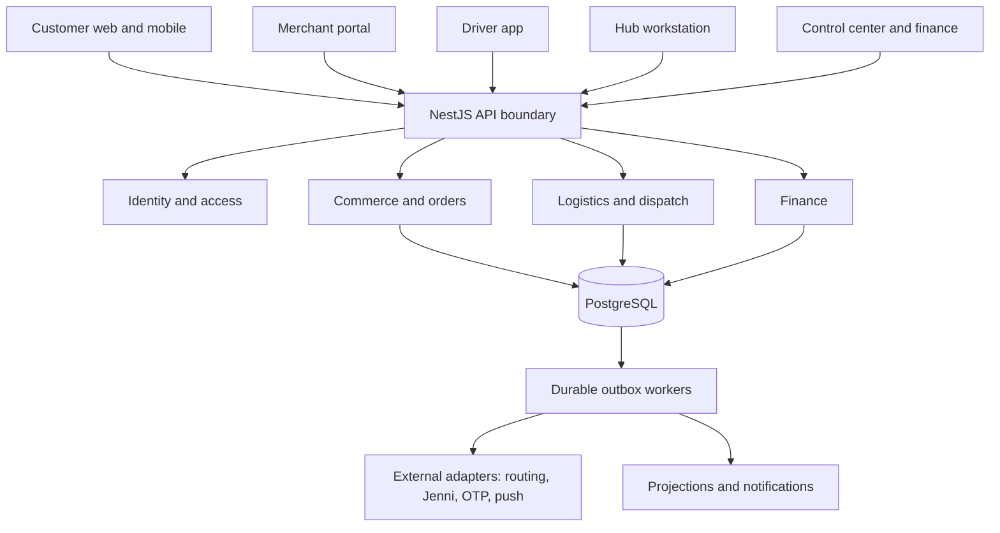

# DilMart 2.0 — System Architecture (Phase 0.3A)

Date: 2026-11-26
Baseline: 625c17715bc5ebc639d5df95c47353df424d4b7d
Status: owner-approved architectural direction; detailed contracts pending review. G0 OPEN.
Scope: design and documentation only. No runtime implementation, DDL, deployment, remote provisioning or feature activation.

## 1. Authority and evidence
Read [Master Spec](00_MASTER_SPEC.md), [repository audit](01_PHASE_0_REPOSITORY_AUDIT.md), [baseline](04_PHASE_0_2_BASELINE_REPORT.md), [database proof](05_PHASE_0_2A_DATABASE_PROOF_REPORT.md), root governance and environment source of truth. PRs 51–54 merged. Local replay applied 175 migrations; 62 public tables with RLS match fresh production counts, not structural equivalence. The only full DB suite exited 1; partial reruns passed applicable failures, one TODO remains. ED-01–06 remain open. No production readiness claim.

## 2. Architectural decisions
| ID | Direction approved | Boundary |
|---|---|---|
| A01 | Evolve existing repository and NestJS modular monolith | No rewrite or microservice split at launch |
| A02 | Existing PostgreSQL/Supabase as transactional authority | Additive migrations after G0; ED-01 object diff before DDL |
| A03 | React/TypeScript existing storefront and merchant/admin surfaces; customer Capacitor | Driver separate app; D09 stack pending device spike |
| A04 | One customer master order, merchant-specific children | Existing orders candidate for reuse; no forced historical conversion |
| A05 | Independent pickup, central cross-dock, consolidated outbound delivery | One initial hub; hub-aware identifiers; no unapproved partial release |
| A06 | Deterministic dispatch and spatial shortlist | PostGIS and routing adapter proposed implementation; weights and provider validation pending |
| A07 | Transactional financial ledger and explicit custody | Money invariants designed before commerce implementation |
| A08 | PostgreSQL durable outbox and idempotent consumers | No Redis unless measured need; in-process events not durable authority |
| A09 | Preserve legacy single-merchant and Jenni path | Provider exclusivity per shipment; default-off V2 flags |
| A10 | Independent staging and gated deployment | No staging provisioning in this phase |

## 3. Logical architecture

API gateway is a logical boundary within NestJS, not a new paid service. Supabase Auth remains identity infrastructure; business-critical mutations go through validated backend commands and transactional RPCs. Public catalog reads may preserve verified existing access patterns. Clients do not receive service-role credentials.

## 4. Domain boundaries and authority
| Domain | Owns | Must not own |
|---|---|---|
| Identity | actor context, roles, tenant/task scope | order or ledger mutations |
| Commerce | product eligibility, price, stock, quote and cart | parcel custody |
| Orders | master/child lifecycle, immutable order snapshots | independent editing of derived delivery or cash truth |
| Merchant fulfillment | acceptance, preparation and readiness | dispatch override or other merchant data |
| Logistics | package, task, shipment and custody records | financial amount recalculation |
| Dispatch | eligibility, offers, capacity, route plans | unguarded reassignment after custody |
| Hub | intake, bin movement, consolidation, packing and release commands | payout approval |
| Finance | allocations, cash custody, liabilities, accrual, reversal, settlement | arbitrary physical parcel state |
| Returns | authorized return workflow coordinating logistics and finance | bypassing custody or refund guards |
| Notifications | delivery of durable events and communication | authoritative state |
| Intelligence | recommendations, operational metrics | autonomous money or custody commands |

These are logical boundaries; Hub and Dispatch may be submodules of Logistics. Exact NestJS folder/module mapping is deferred to detailed contracts. Cross-domain atomic operations use a designated transaction coordinator or RPC with explicit invariants; no circular service dependency or multi-write best-effort workflow for critical state.

## 5. Commerce-to-delivery flow
1. Customer creates an authoritative quote across eligible merchants.
2. Idempotent submit creates master and single-merchant children with stock effect, financial snapshots and durable events atomically.
3. Merchant acceptance and readiness are separate. Rejection or timeout follows approved compensation policy.
4. Ready parcels are picked up by independently assigned eligible drivers, with manifest and scan evidence.
5. Hub acknowledges custody, checks condition, sorts into consolidation bins and releases only verified complete groups (exceptions require approved policy).
6. Last-mile shipment carries consolidated parcels; driver records delivery proof and exact COD.
7. Finance reconciles cash handover and merchant/driver liabilities; payouts and reversals remain auditable.

Master status is a projection, not a separately editable truth. One merchant may supply multiple parcels; a pickup task may batch compatible parcels; one shipment may consolidate several children. Exact cardinalities, constraints and transitions belong to 0.3B–H.

## 6. Reuse versus extension
| Existing evidence | Direction |
|---|---|
| src/lib/cart-store.ts single-merchant guard | Adapt behind V2 flag; preserve legacy |
| checkout.service.ts and place_order RPC | Reuse proven validation and stock/rollback patterns; new atomic master contract |
| delivery-operations.service.ts | Adapt proven scope/transition patterns; introduce parcel/task/custody authority; ED-02 |
| AgentOrders and admin DeliveryOps/DeliveryIntelligence | Reuse UI patterns, not order-grain assumptions |
| order-finance.service.ts and payout/return RPCs | Preserve historical liabilities; design atomic accrual or durable recovery |
| notification_outbox and worker tests | Evaluate reusable leasing/dedupe patterns; no assumption existing queue fits all events |
| Supabase RLS and backend actor guards | Extend tenant and task scope with adversarial tests |
| Capacitor customer build | Preserve mobile boundary; separate driver device evaluation |

No legacy B2B/federated tables are to be resurrected. Stage B removed them. Compatibility means preserving supported current behavior, not restoring retired flows.

## 7. Consistency and failure model
- All commands validate actor, scope, payload, idempotency and expected version where applicable.
- Lock resources in deterministic order; use unique business constraints for retry-safe effects.
- Persist business state and outbox event in the same transaction. At-least-once delivery; idempotent business effect, not a claim of exactly-once transport.
- Delivery/finance boundary must be atomic or durably recoverable; reconcile before payout. No reliance on swallowed in-process handler errors.
- Unknown barcode or inconsistent custody goes to exception/quarantine, not a fabricated successful transition.
- External calls occur outside long-running DB transactions; timeouts create retry/exception records. No implicit duplicate Jenni dispatch.
- Offline driver commands are scoped, queued, versioned and replay-safe; stale conflicts go to dispatcher resolution.
- Monetary amounts use integer IQD with deterministic allocations and conservation; precise fee/refund rules pending D06/D07.

## 8. Deployment and operational topology
Existing production: GitHub main, Netlify storefront, Render Store API, Supabase Store database. Follow ai/ENVIRONMENT_SOURCE_OF_TRUTH.md for exact identity. Render free is a testing constraint, not a commercial SLA. Android rebuild, Auth Hooks, CORS and Jenni acceptance remain ED-06. Do not delete old services from this design.

Proposed isolated staging: distinct Supabase project, Render service and frontend target, synthetic fixtures and separate credentials, verified environment binding, no raw production PII. No provisioning authorized. Local disposable proof must use unique resources and network isolation; do not touch pre-existing stacks. Design backup/restore, monitoring, migration rehearsals and cohort flags before activation.

## 9. Security and quality
RLS plus backend object-level authorization; least privilege; scoped driver/customer data; immutable financial/custody audit; no secrets or PII in public Git. ED-03 review definer search paths and EXECUTE grants before exposure; ED-04 triage exploitable runtime advisories before pilot; ED-05 no-new-diagnostics strategy with actual baseline comparison. Full clean DB suite and structural schema comparison remain outstanding. No global lint rewrite. Use T01–T23 from master spec as acceptance anchors; exact load and field pilot thresholds pending.

## 10. Contract design sequence
| Package | Planned document | Dependency |
|---|---|---|
| 0.3A | 06_SYSTEM_ARCHITECTURE.md | baseline |
| 0.3B | 07_COMMERCE_ORDER_CONTRACTS.md | A; finance invariants coordinated |
| 0.3C | 08_MERCHANT_FULFILLMENT.md | B |
| 0.3D | 09_INTELLIGENT_DISPATCH.md | B/C and hub constraints |
| 0.3E | 10_HUB_PARCEL_MANAGEMENT.md | B/C/D |
| 0.3F | 11_DRIVER_APPLICATION.md | D/E; device evidence |
| 0.3G | 12_FINANCIAL_ARCHITECTURE.md | B/E; early invariant review |
| 0.3H | 13_DATABASE_API_CONTRACTS.md | B–G |
| 0.3I | 14_SECURITY_STAGING_QA.md | A–H |
| 0.3J | 15_IMPLEMENTATION_ROADMAP.md, 16_ARCHITECTURE_DECISION_REGISTER.md, 17_G0_APPROVAL_GATE.md | all packages |

The sequence is dependency-aware, not a waterfall: finance constraints and security review start with commerce. D01–D13 remain open unless individually recorded and approved; operational values (fees, fleet, hub, cash limits, SLA, routing coverage) are not invented. December 25 is a conditional target, not a guarantee.

## 11. Exit gate
0.3A establishes direction, not final G0. Review each contract with owner; record decisions and explicit deferrals, evidence and release blockers. G0 requires approved implementation contracts and isolated environment readiness; ED-01 structural proof before DDL, clean DB suite before implementation acceptance, no unaddressed critical integrity risks. No V2-01–08 work until separate explicit authorization. This document does not authorize deployment, migrations, flags or production access.
